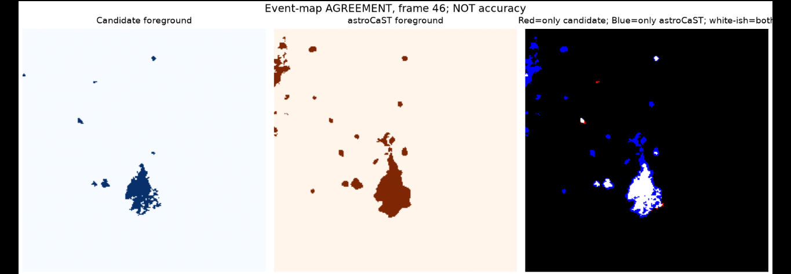

# AstroCellLink

**Exploring how astrocytic calcium events can be detected, followed through time, and linked to individual cells.**

AstroCellLink is an open-source **research prototype** built alongside the ideas introduced in [astroCaST](https://github.com/janreising/astroCAST). It brings together event-map analysis, cell-mask tracking, conservative event-to-cell attribution, and tools for understanding where two detection methods disagree.

I started this project with a practical question: *when a calcium event is detected in a busy astrocyte imaging field, what can we actually say about the cell it belongs to?* Finding an active region is one task. Assigning that activity to a particular astrocyte, especially where processes overlap, is a much harder one.

The project is a way to investigate that gap, not a claim that it has already been solved. **Real-cell attribution remains unvalidated.** AstroCellLink is independent of the official astroCaST project and does not replace its detector.

## A look at the analysis



*An actual exploratory comparison on the public ExVivo recording (frame 46): left, an independent event-screening candidate mask; center, astroCaST 0.4.2; right, overlap (light), candidate-only pixels (red), and astroCaST-only pixels (blue). This figure illustrates **agreement**, not ground-truth accuracy.*

## What is implemented

- **Event-aware analysis:** read labeled `(time, y, x)` event stacks from astroCaST `.roi` folders, TIFF, or NumPy arrays.
- **Cell tracking:** match per-frame instance masks through time using overlap and distance, while allowing uncertain cases to remain unresolved.
- **Conservative cell attribution:** calculate geometric overlap between events and tracked cell masks; flag ambiguous or weak assignments instead of forcing an identity.
- **Reference-mask evaluation:** compare proposed instance masks with expert annotations when those annotations are available.
- **Detector comparison:** calculate voxel-level foreground Jaccard, greedy one-to-one event matches, and event-level 3D IoU against astroCaST outputs. These are **agreement** metrics.
- **Experimental spatiotemporal hysteresis (v0.3):** expand existing labeled event seeds into nearby fluorescence-supported voxels in space and time; preserve original event IDs and report competing-seed regions. This stage **does not discover new events** and has not yet been validated on independent biological ground truth.
- **Exploratory QC scripts:** inspect onset times, lag sensitivity, spatial controls, and individual calcium events. They live under `scripts/exploratory/` rather than being presented as validated scientific estimators.

The structural segmentation option is **an Otsu/watershed baseline**, not a trained neural network. Fluorescence-only recordings do not provide reliable cell identities by themselves.

## Quick start

Python 3.9+ is required for AstroCellLink. A separate Python 3.10 environment is recommended if you also want to run *official astroCaST 0.4.2*.

```bash
python3 -m venv .venv
source .venv/bin/activate
python -m pip install --upgrade pip
python -m pip install -e '.[test]'
python -m pytest -q

# A synthetic example with known labels (not a biological validation)
astrocelllink demo --output demo_output
```

The demo writes diagnostic images, event attribution, tracked masks, and a synthetic-only evaluation to `demo_output/results/`.

### Use actual cell masks

```bash
astrocelllink run \
  --event-map /path/to/recording.roi \
  --instance-masks /path/to/cell_instance_masks.tiff \
  --output results/cell_attribution
```

Instance masks must be **co-registered** with the event map. A structural marker or reviewed manual labels is strongly preferable to deriving identities from calcium-bright structures alone.

### Compare detectors on the same data

```bash
astrocelllink compare-events \
  --candidate /path/to/candidate_event_map.tiff \
  --astrocast /path/to/astrocast_output.roi \
  --min-iou 0.10 \
  --frame 46 \
  --output results/detector_comparison
```

Ensure identical array shapes, frame order, spatial registration and preprocessing definitions. Greedy matching is **not** a globally optimal split/merge analysis.

### Experimental v0.3: fluorescence-guided growth

```bash
astrocelllink hysteresis \
  --candidate /path/to/candidate_event_map.tiff \
  --movie /path/to/recording.h5 \
  --dataset dff/ch0 \
  --weak-z 1.0 \
  --spatial-radius 2 \
  --temporal-radius 2 \
  --min-consecutive 2 \
  --output results/hysteresis_v03
```

The output includes `refined_event_map.tiff`, a QC figure, per-event growth statistics and a JSON summary. Parameters above are **exploratory starting values**, not optimized performance claims. Pass `--reference /path/to/astrocast_output.roi/event_map.tiff` to *measure* agreement after running; the reference is not used to decide where voxels grow. Input seed IDs remain unchanged.

## ExVivo benchmark: what we actually observed

We ran astroCaST 0.4.2 and an independent candidate-screening script on the **same 281-frame ExVivo recording** at 251 × 251 spatial resolution. The comparison was made on event-label maps, *without expert ground-truth labels*.

| Measure | Observed value |
| --- | ---: |
| Candidate events from the exploratory screen | 335 |
| Events from official astroCaST 0.4.2 | 425 |
| Greedy one-to-one event matches (3D IoU ≥ 0.10) | 155 |
| Foreground Jaccard | 0.1680 |
| Mean IoU among matched events | 0.2902 |

The two maps often detect activity in the same general areas but disagree substantially on event boundaries and how activity is grouped. For example, candidate event **194** overlapped astroCaST event **212** by 3,686 voxels; almost the entire candidate event was inside the larger astroCaST event. Seven candidate IDs overlapped event 212 in total. That observation suggests a meaningful **split/merge and boundary-definition question**, not that either method is more accurate.

The latest v0.3 hysteresis module has passed synthetic tests but **has not yet been benchmarked on the actual ExVivo data**. Do not confuse the v0.2 screening measurements above with v0.3 performance. See [the benchmark notes](docs/EXVIVO_BENCHMARK.md) for context.

## Why the distinction matters

Astrocyte processes can overlap, calcium signals can be spatially connected across time, and segmentation depends on threshold selection. A high event overlap with another detector does not establish the biological origin of an event. Nor does a consistent spatial onset gradient, by itself, demonstrate a propagating calcium wave.

The roadmap is therefore deliberately conservative: benchmark the detector across recordings, evaluate splits and merges against expert annotations, obtain independently reviewed cell masks, and only then quantify event-to-cell accuracy. The current implementation is an **engineering research prototype**, not a clinical, diagnostic or peer-reviewed biological measurement tool.

## Data, tests and reproducibility

- `astrocelllink/` — core package (tracking, attribution, comparison, preliminary segmentation, experimental hysteresis)
- `tests/` — automated **synthetic and interface checks** (30 passing in the release environment)
- `scripts/exploratory/` — standalone analyses and screening, supplied as research utilities
- `examples/demo_precomputed/` — **synthetic** sample inputs and expected outputs
- `scripts/run_upstream_astrocast.sh` — official detector invocation in its own Python 3.10 environment
- [`QUICKSTART_v0.3_FA.md`](QUICKSTART_v0.3_FA.md) — Persian/Linux Mint notes for upgrading and running the experimental module

The public ExVivo HDF5 recording and other large biological data are **not included** in this repository. The example TIFF files are synthetic. Keep private recordings, credentials, entire `.venv` folders and other local files outside version control.

## Credits and citation

AstroCellLink was developed as an **independent exploratory project** motivated in part by:

Reising, J. P., González-Sánchez, A. C., Samara, A., & Herlenius, E. (2024). *Astrocytic Calcium Signaling Toolkit (astroCaST): efficient analysis of dynamic astrocytic calcium events.* Frontiers in Cellular Neuroscience, 18, 1408607. [DOI: 10.3389/fncel.2024.1408607](https://doi.org/10.3389/fncel.2024.1408607).

Official upstream code: [janreising/astroCAST](https://github.com/janreising/astroCAST). This repository contains **no upstream astroCaST source code** and is not affiliated with or endorsed by the original team.

## License

MIT — see [LICENSE](LICENSE).
